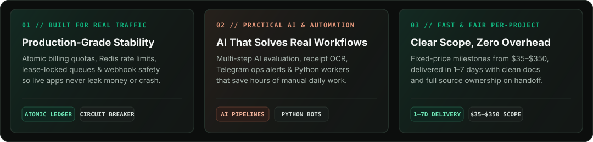

  

    

  
  
  

 

I build **production-ready web apps, payment integrations, and Python automation bots** for founders, indie makers, and small businesses — with reliable architecture and practical AI where it genuinely saves time or improves product quality.

🇻🇳 Xem giới thiệu tiếng Việt (Click to expand)

Mình chuyên thiết kế và phát triển **Web App (Next.js / React), tích hợp thanh toán, và Tool/Bot tự động hóa bằng Python** theo từng dự án gọn nhẹ (**$35–$350** / **800k–8M VNĐ**, bàn giao trong **1–7 ngày**). Tập trung vào sự ổn định, bảo mật giao dịch, xử lý lỗi thực tế và bàn giao code sạch dễ vận hành.

 

  

---

### Selected Production Work

| System | Role & Architecture | Live / Impact |
| :--- | :--- | :--- |
| **[IELTSUp](https://www.ieltsup.app)** — Multi-Examiner IELTS Writing & Speaking SaaS | **Next.js 16 + React 19 Monorepo** + Express worker backend, Upstash Redis rate limiting, Firebase Auth, **multi-examiner AI scoring with blind discrepancy adjudication**, and **atomic quota ledger** (`RESERVED -> COMMITTED \| REFUNDED`) across PayOS, Stripe & Crypto webhooks. | **[ieltsup.app](https://www.ieltsup.app)** · Live production SaaS |
| **Automated Digital Fulfillment & Dispute Verification System** *(Private Prod)* | **Python + Flask Blueprints**, **SQLite WAL + Supabase RPC** lease-locked FIFO queues, rotating proxy circuit breaker, **AI Vision OCR payment verification** (`>95%` accuracy), and live Telegram ops alerts. | Zero double-claims · Automated daily order fulfillment & ops |

---

### How I Can Help (Fast, Fixed-Scope Projects)

| Service Scope | Typical Deliverables | Turnaround | Budget |
| :--- | :--- | :---: | :---: |
| **Bug Fixing, Optimization & Deployment** | Fix auth/payment race conditions, resolve API timeouts, harden database locks, and deploy to Vercel / Render / VPS | **1 – 2 days** | **$35 – $100** |
| **Python Automation, Scrapers & Ops Bots** | Telegram / Discord ops bots, resilient Playwright/HTTP scrapers, CSV/CRM pipelines, and OCR verification scripts | **2 – 4 days** | **$50 – $180** |
| **Full-Stack Web MVP & SaaS Features** | Next.js + Tailwind web app, login & user dashboard, Stripe / PayOS billing webhooks, and structured AI workflows | **4 – 7 days** | **$120 – $350** |

---

### Core Stack

---

Need a reliable web app, automation script, or quick production fix without full-time overhead?

**[🌐 View Interactive Portfolio](https://minhtri12995.github.io)** &nbsp;·&nbsp; **[⚡ Send a 30s Project Brief](https://github.com/MinhTri12995/MinhTri12995/issues/new?template=project-inquiry.yml)**

