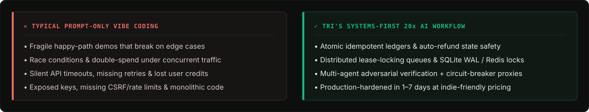

  

  

    
    
    
    
  

---

### ⚡ Why Systems-First Vibe Coding?

Most "vibe-coded" apps fall apart the moment real users hit them — silent API drops, race conditions, broken auth, or leaked credentials.

I pair **20x Frontier AI Agent Orchestration** (*Antigravity, Gemini Ultra, Claude, Codex*) with **practical Systems Engineering** (*atomic ledgers, lease-locked queues, multi-agent adjudication, circuit-breaker proxies, and strict security boundaries*). You get production-grade software shipped in **days instead of weeks**, at **accessible, per-project indie rates** — no agency overhead or full-time commitment required.

<strong>🇻🇳 Phiên bản ngắn Tiếng Việt (Click để xem)</strong>

Mình là **Nguyễn Minh Trí** — **Systems-First Vibe Coder**. Thay vì chỉ prompt tạo demo dễ lỗi khi chạy thật, mình kết hợp **năng lực điều phối 20x AI Agents** cùng **tư duy thiết kế hệ thống** (hàng đợi chống đụng độ, ledger giao dịch nguyên tử, cơ chế fallback & bảo mật API) để biến ý tưởng thành **Web App AI, Micro-SaaS, hoặc Tool tự động hóa Python** chạy ổn định chỉ trong **1–7 ngày** với chi phí tối ưu cho từng job lẻ.

👉 **[Xem Portfolio & Tạo Brief 30 giây](https://minhtri12995.github.io)** · **[Gửi yêu cầu trực tiếp qua GitHub](https://github.com/MinhTri12995/MinhTri12995/issues/new?template=project-inquiry.yml)**

 

---

### 🏗️ Shipped Production Systems (Case Studies)

> *Core source repositories stay private to protect commercial IP and client data; live deployments and architectural breakdowns are shared below.*

| System | Stack & Infra | Systems Engineering Highlights | Access |
| :--- | :--- | :--- | :--- |
| **01 · IELTSUp**  *Multi-Examiner AI EdTech SaaS* | `Next.js 16` · `React 19` · `TypeScript` · `Firebase` · `Upstash Redis` · `Render` · `Vercel` | **4-stage evaluation pipeline** (`@ielts/evaluation-core`): Vision AI chart extraction → character-offset proofreader → **parallel 2-Examiner AI panel + Blind Adjudication** on ≥ 1.0 band variance → **idempotent credit ledger** with source-aware auto-refund; Stripe, PayOS & Crypto billing. | [Live App ↗](https://ielts-gemini-pro.vercel.app) |
| **02 · Digital Vault & AI Dispute Engine**  *Automated Operations Platform* | `Python` · `Flask Blueprints` · `SQLite WAL` · `Supabase RPC` · `Rotating Proxy` | **Atomic lease-locking worker queue** (zero double-claims under concurrency), **circuit-breaker rotating proxy gateway**, dual-source session verifier, **AI Vision OCR** payment card matching (>95% accuracy) for dispute resolution, CSRF/rate-limit hardening & Telegram ops alerts. | *Private Prod* |
| **03 · TriGPT Workspace**  *Unified Multi-LLM Chat Client* | `React` · `Vite` · `Express SSE` · `Firebase Auth` · `Firestore` | Streams **65+ frontier & open-weight models** in real time via a unified OpenAI-compatible SSE proxy, with server-side secret isolation, multi-mode reasoning selector, and graceful fallback degradation. | [Live App ↗](https://trigpt0810.vercel.app) |

---

### 🛠️ Bite-Sized Services & Indie-Friendly Rates

Looking for a quick build, an AI integration, or someone to rescue a broken prototype? Pick a scoped gig:

| Service | Typical Scope | Turnaround | Starting Rate |
| :--- | :--- | :---: | :---: |
| **⚡ Python Automation, Scrapers & Bots** | Data pipelines, proxy-resilient scrapers, Telegram/Discord bots, API bridges, OCR workflows | `1–3 days` | **From $35+** |
| **🛠️ Vibe-Code Rescue & Hardening** | Fix auth/DB bugs in Cursor/Bolt/Lovable apps, eliminate race conditions, secure APIs & deploy live | `1–3 days` | **From $50+** |
| **🚀 Fast-Track AI Web App / SaaS MVP** | Full-stack Next.js/React/Python AI app with auth, database, LLM streaming & payment integration | `3–7 days` | **From $120+** |

> 💬 **Have a small task or tight student/indie budget?** [Send a 30-second project brief →](https://github.com/MinhTri12995/MinhTri12995/issues/new?template=project-inquiry.yml) or use the [Interactive Brief Builder on my Portfolio →](https://minhtri12995.github.io/#estimate)

---

### ⚙️ AI Orchestration & Engineering Stack

  
  
  
  
  
  

